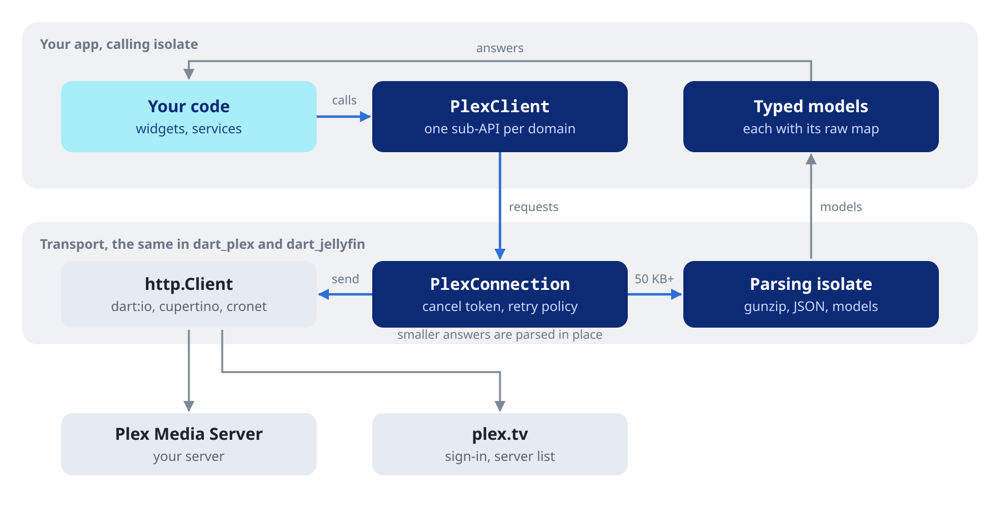

# dart_plex

#### Plex Media Server client for Flutter and Dart.

[](https://pub.dev/packages/dart_plex)
[](https://plexapi.dev)
[](LICENSE)
[](https://github.com/ales-drnz/dart_plex)
[](https://discord.gg/g2Qf4Mq9MP)
[](https://www.patreon.com/cw/ales_drnz)
[](https://www.buymeacoffee.com/ales.drnz)

<table>
<tr>
<td valign="middle" width="90"></td>
<td valign="middle"><code>dart_plex</code> is a Dart client for Plex Media Server 1.43. It covers libraries, playlists, streaming, playback reporting, play queues and search through typed Dart objects, and handles plex.tv sign-in and server discovery.</td>
</tr>
</table>

---

## Installation

Add `dart_plex` to your `pubspec.yaml`:

```yaml
dependencies:
  dart_plex: ^0.3.0
```

---

## Features

<table>
<tr>
<td valign="middle" width="48"></td>
<td valign="middle" width="45%"><b>Pure Dart</b><br>no native plugin and no Flutter dependency. The main library also runs on the web; only the file helpers in <code>io.dart</code> need <code>dart:io</code>.</td>
<td valign="middle" width="48"></td>
<td valign="middle" width="45%"><b>Typed models</b><br>libraries, items, media, streams, hubs, server info, history and events are typed Dart objects, each with a <code>raw</code> map for the fields it does not lift.</td>
</tr>
<tr>
<td valign="middle"></td>
<td valign="middle"><b>JWT sign-in</b><br>an Ed25519 <a href="https://pub.dev/documentation/dart_plex/latest/topics/Client%20and%20sign-in-topic.html">device key</a> and 7-day plex.tv tokens the client refreshes on its own, with the legacy PIN and password flows still there.</td>
<td valign="middle"></td>
<td valign="middle"><b>Server discovery</b><br><code>fetchResources()</code> lists owned and shared servers; <a href="https://pub.dev/documentation/dart_plex/latest/topics/Client%20and%20sign-in-topic.html"><code>connectToResource()</code></a> tries every connection at once and takes the best that answers, IPv6 included.</td>
</tr>
<tr>
<td valign="middle"></td>
<td valign="middle"><b>One client</b><br>a <code>PlexClient</code> holds the identity, the server and the token, and every sub-API works through it.</td>
<td valign="middle"></td>
<td valign="middle"><b>Streaming</b><br><a href="https://pub.dev/documentation/dart_plex/latest/topics/Streaming-topic.html"><code>startAudioTranscode()</code></a> and <code>startVideoTranscode()</code> make the decision and return the URL; <a href="https://pub.dev/documentation/dart_plex/latest/topics/Streaming-topic.html"><code>directFileUrl()</code></a> gives the original file.</td>
</tr>
<tr>
<td valign="middle"></td>
<td valign="middle"><b>Your HTTP stack</b><br><a href="https://pub.dev/documentation/dart_plex/latest/topics/Client%20and%20sign-in-topic.html">any <code>http.Client</code></a>: the default <code>dart:io</code> one, <code>cupertino_http</code> or <code>cronet_http</code> for HTTP/2 and the system proxy, a <code>MockClient</code> in tests.</td>
<td valign="middle"></td>
<td valign="middle"><b>Off the calling isolate</b><br>large responses are inflated, decoded and parsed into models on a background isolate.</td>
</tr>
<tr>
<td valign="middle"></td>
<td valign="middle"><b>Cancellation and retries</b><br><a href="https://pub.dev/documentation/dart_plex/latest/topics/Errors%20and%20paging-topic.html"><code>withCancelToken()</code></a> makes every call of a page cancellable; an opt-in <a href="https://pub.dev/documentation/dart_plex/latest/topics/Errors%20and%20paging-topic.html"><code>PlexRetryPolicy</code></a> resends idempotent requests after transient failures.</td>
<td valign="middle"></td>
<td valign="middle"><b>Live events</b><br>the server's notifications decoded into a sealed <a href="https://pub.dev/documentation/dart_plex/latest/topics/Events%20and%20downloads-topic.html"><code>PlexEvent</code></a> type: play states, library changes, scans.</td>
</tr>
<tr>
<td valign="middle"></td>
<td valign="middle"><b>Typed errors</b><br>every failure is a <a href="https://pub.dev/documentation/dart_plex/latest/topics/Errors%20and%20paging-topic.html"><code>PlexException</code></a> you can branch on: auth, not found, network, transient, cancelled.</td>
<td valign="middle"></td>
<td valign="middle"><b>Escape hatch</b><br><a href="https://pub.dev/documentation/dart_plex/latest/topics/Raw%20requests-topic.html"><code>request()</code></a>, <code>requestBytes()</code> and <code>requestStream()</code> reach endpoints the typed sub-APIs do not cover.</td>
</tr>
</table>

---

## Quick start

```dart
import 'package:dart_plex/dart_plex.dart';

Future<void> main() async {
  final plex = PlexClient(
    credentials: const PlexCredentials(
      clientIdentifier: 'PUT-YOUR-UUID-HERE', // stable per install
      product: 'MyApp',
      version: '1.0.0',
      device: 'iPhone',
      deviceName: 'My iPhone',
      platform: 'iOS',
    ),
  );

  // 1. Sign in with a device key: the user approves the PIN in a browser.
  final key = await PlexDeviceKey.generate(); // persist it, see Client and sign-in
  var pin = await plex.account.createJwtPin(key: key);
  print('Sign in at ${plex.account.authAppUrl(pin)}');
  while (!pin.isAuthenticated) {
    await Future<void>.delayed(const Duration(seconds: 1));
    pin = await plex.account.pollJwtPin(id: pin.id, key: key);
  }
  // The JWT lasts 7 days; the client refreshes it with the key.
  await plex.useJwt(
    PlexJwtSession(key: key, token: PlexJwt.parse(pin.authToken!)),
  );

  // 2. Find the user's server and connect through the best connection
  //    that answers.
  final servers = await plex.account.fetchResources();
  final server = servers.firstWhere((s) => s.owned);
  await plex.connectToResource(server);

  // 3. Browse the music library.
  final sections = await plex.library.sections();
  final music = sections.firstWhere((s) => s.type == PlexLibraryType.music);
  final albums = await plex.library.allByType(
    sectionId: music.id,
    type: PlexMetadataType.album,
    sort: PlexSort.titleSort.asc,
  );

  // 4. Stream the first track of the first album.
  final tracks =
      await plex.library.children(ratingKey: albums.items.first.ratingKey);
  final transcode = await plex.streaming.startAudioTranscode(
    ratingKey: tracks.first.ratingKey,
    session: 'a-uuid-per-playback',
    maxAudioBitrateKbps: 192,
  );
  print(transcode.url); // hand this to your audio engine

  // 5. Release the HTTP client.
  plex.close();
}
```

### How it works

`PlexClient` holds the identity of your app, the server and the token. Each part of the Plex API is a sub-API on it (`plex.library`, `plex.playlists`, `plex.streaming` and so on), and every call goes through one connection, the same transport `dart_jellyfin` uses.



---

## Working with the client

### A client for tests

```dart
final plex = PlexClient(
  credentials: credentials,
  httpClient: MockClient((request) async => http.Response(
        '{"MediaContainer":{"size":0,"Directory":[]}}',
        200,
        headers: {'content-type': 'application/json'},
      )),
);
```

Any `http.Client` works, such as `cupertino_http` or `cronet_http` for HTTP/2 and the system proxy. See [Client and sign-in](https://pub.dev/documentation/dart_plex/latest/topics/Client%20and%20sign-in-topic.html) for the constructor options, credentials, both sign-in flows and how a connection is picked.

### The server

```dart
final info = await plex.server.info();
print('${info.friendlyName} ${info.version}, sonic analysis: ${info.musicAnalysis}');

final running = await plex.activities.list();
final scan = running.where((a) => a.cancellable).firstOrNull;
if (scan != null) await plex.activities.cancel(activityId: scan.uuid);
```

See [Server](https://pub.dev/documentation/dart_plex/latest/topics/Server-topic.html) for butler tasks, settings, the log, updates and the other admin calls.

### Filtered browsing

```dart
final page = await plex.library.allByType(
  sectionId: music.id,
  type: PlexMetadataType.album,
  filters: [PlexFilter.genre(6), PlexFilter.yearAfter(2009)],
  sort: PlexSort.addedAt.desc,
);
print('Got ${page.items.length} of ${page.totalSize}');
```

See [Library](https://pub.dev/documentation/dart_plex/latest/topics/Library-topic.html) for sections, filters, facets, collections, editing and sonic radio.

### Reporting a play

```dart
await plex.playback.timeline(
  ratingKey: track.ratingKey,
  playState: PlexPlayState.playing,
  timeMs: 42000,
  durationMs: track.durationMs!,
);
```

Send a report on every state change and every 10 s while playing. See [Playback and play queues](https://pub.dev/documentation/dart_plex/latest/topics/Playback%20and%20play%20queues-topic.html) for when a play counts, ratings, sessions, history and server play queues.

### A playlist

```dart
final playlist = await plex.playlists.create(
  title: 'My Mix',
  type: PlexMediaType.audio,
  machineIdentifier: machineId,
  itemRatingKeys: const ['12345', '12346'],
);
```

See [Playlists](https://pub.dev/documentation/dart_plex/latest/topics/Playlists-topic.html) for listing, editing entries, smart playlists and import.

### A transcode to keep alive

```dart
final transcode = await plex.streaming.startAudioTranscode(
  ratingKey: track.ratingKey,
  session: sessionId,
  maxAudioBitrateKbps: 128,
);
await plex.streaming.pingUniversal(session: sessionId); // every 30 s while paused
await plex.streaming.stopUniversal(session: sessionId); // when the user leaves
```

The calls return URLs and never fetch the audio. See [Streaming](https://pub.dev/documentation/dart_plex/latest/topics/Streaming-topic.html) for video transcodes over HLS, DASH or HTTP, the remote-streaming pass, direct files, transcoder URLs, lyrics and loudness.

### Live TV

```dart
final dvrs = await plex.liveTv.dvrs();
await plex.dvrs.tuneChannel(dvrId: dvrId, channel: '2.1');
final rules = await plex.subscriptions.list();
```

The answers are typed (`PlexDvr`, `PlexMediaSubscription`, …). See [Live TV](https://pub.dev/documentation/dart_plex/latest/topics/Live%20TV-topic.html) for sessions, DVRs, recording rules, tuners and the program guide.

### Errors

```dart
try {
  await plex.library.sections();
} on PlexException catch (e) {
  if (e.isPassRequired) showPassNeeded(); // remote video needs a pass
  else if (e.isAuthError) await signInAgain();
  else if (e.isTransient) scheduleRetry(e.retryAfter);
  else showError(e.message);
}
```

See [Errors and paging](https://pub.dev/documentation/dart_plex/latest/topics/Errors%20and%20paging-topic.html) for the error types, cancel tokens, the retry policy and paging. [Raw requests](https://pub.dev/documentation/dart_plex/latest/topics/Raw%20requests-topic.html) reach the endpoints the sub-APIs do not cover.

### Search as you type

```dart
searchToken?.cancel(); // drop the previous keystroke's request
final token = searchToken = PlexCancelToken();
final hubs = await plex.withCancelToken(token).search.hubs(query: text);
```

See [Search](https://pub.dev/documentation/dart_plex/latest/topics/Search-topic.html) for hub, section, flat and voice search.

### Live events

```dart
final frames = await plex.notifications.connectWebSocket();
frames.events().listen((event) {
  if (event is PlexActivityEvent && event.isLibraryScan && event.isEnded) {
    reloadLibrary();
  }
});
```

See [Events and downloads](https://pub.dev/documentation/dart_plex/latest/topics/Events%20and%20downloads-topic.html) for every event type and for downloads to disk.

### Artwork

```dart
final url = plex.images.transcodeUrl(sourcePath: album.thumb!, width: 300, height: 300);
final cacheKey = '${album.ratingKey}@${album.thumbVersion}';
```

See [Images and hubs](https://pub.dev/documentation/dart_plex/latest/topics/Images%20and%20hubs-topic.html) for artwork versions, UltraBlur backdrops and the home screen's hubs.

---

## Documentation

- [API reference](https://pub.dev/documentation/dart_plex/latest/), with these guides:
  - [Client and sign-in](https://pub.dev/documentation/dart_plex/latest/topics/Client%20and%20sign-in-topic.html): the client, credentials, the HTTP stack, tests, JWT and PIN sign-in, Plex Home, the watchlist and connecting to a server
  - [Server](https://pub.dev/documentation/dart_plex/latest/topics/Server-topic.html): identity, activities, butler tasks, settings and administration
  - [Library](https://pub.dev/documentation/dart_plex/latest/topics/Library-topic.html): sections, items, filters, collections, editing and sonic radio
  - [Playlists](https://pub.dev/documentation/dart_plex/latest/topics/Playlists-topic.html): listing, creating and editing playlists, smart playlists and import
  - [Search](https://pub.dev/documentation/dart_plex/latest/topics/Search-topic.html): hub, section, flat and voice search
  - [Playback and play queues](https://pub.dev/documentation/dart_plex/latest/topics/Playback%20and%20play%20queues-topic.html): timeline reports, ratings, sessions, history and play queues
  - [Streaming](https://pub.dev/documentation/dart_plex/latest/topics/Streaming-topic.html): audio and video transcodes, the remote-streaming pass, direct files, lyrics and loudness
  - [Images and hubs](https://pub.dev/documentation/dart_plex/latest/topics/Images%20and%20hubs-topic.html): resized artwork, cache keys, UltraBlur and hubs
  - [Live TV](https://pub.dev/documentation/dart_plex/latest/topics/Live%20TV-topic.html): live sessions, DVRs, recording rules, tuners and the guide
  - [Errors and paging](https://pub.dev/documentation/dart_plex/latest/topics/Errors%20and%20paging-topic.html): typed errors, cancellation, retries and paging
  - [Events and downloads](https://pub.dev/documentation/dart_plex/latest/topics/Events%20and%20downloads-topic.html): notifications, typed events, downloads and download queues
  - [Raw requests](https://pub.dev/documentation/dart_plex/latest/topics/Raw%20requests-topic.html): `request()`, `requestBytes()` and `requestStream()`
- [Example](example/dart_plex_example.dart)
- [CHANGELOG](CHANGELOG.md) and [MIGRATION](MIGRATION.md)

---

## Project background

I wrote the typed models, the sub-APIs and the transport with Claude Code.

Plex is a trademark of Plex, Inc. dart_plex is not affiliated with it.

---

*Developed by Alessandro Di Ronza*
