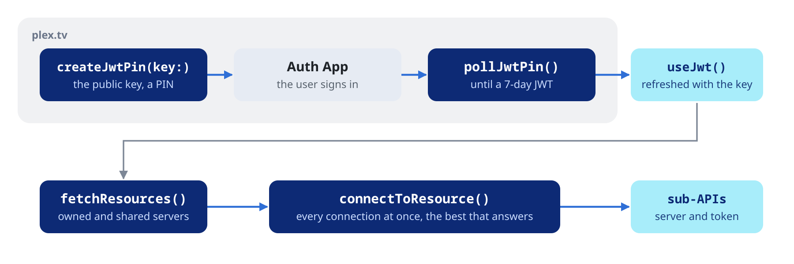

Create and close a client, choose its HTTP stack, sign in at plex.tv and connect to a server.

## Initialization and lifecycle


### Creating a client

```dart
final plex = PlexClient(
  credentials: const PlexCredentials(
    clientIdentifier: '2f5b-…-uuid',
    product: 'MyApp',
    version: '1.0.0',
    device: 'iPhone',
    deviceName: 'My iPhone',
    platform: 'iOS',
  ),
);
```

The other constructor arguments are optional:

| Argument | Default | Description |
| :--- | :--- | :--- |
| `httpClient` | a `dart:io` client owned by `PlexClient` | Any `http.Client`, see Choosing the HTTP stack below |
| `connectTimeout` | 15 s | The handshake (default client) and, with `receiveTimeout`, the wait for response headers |
| `receiveTimeout` | 30 s | Also bounds every pause inside a response body |
| `jsonIsolateThreshold` | 50 KB | Responses this large or larger are decoded and parsed on a background isolate |
| `retryPolicy` | `PlexRetryPolicy.none` | See [Requests and errors](https://pub.dev/documentation/dart_plex/latest/topics/Requests%20and%20errors-topic.html) |

Above `jsonIsolateThreshold` the JSON decode and the walk that builds the
typed models both run on a background isolate, and so does the gzip
inflate of the default client. Pass `0` to send every response there, or
a very large value to keep everything on the calling isolate.

### Credentials

`PlexCredentials` describes the client. Every request carries the
matching `X-Plex-*` headers. `clientIdentifier` must be a stable UUID per
installation: generate it once, store it (SharedPreferences, Keychain,
Android Keystore) and reuse it. A new identifier invalidates the tokens
issued to the old one.

The optional fields:

| Field | Header |
| :--- | :--- |
| `platformVersion` | `X-Plex-Platform-Version` |
| `model` | `X-Plex-Model`, such as `'iPhone14,2'` |
| `deviceVendor` | `X-Plex-Device-Vendor`, such as `'Apple'` |
| `marketplace` | `X-Plex-Marketplace`, such as `'googlePlay'` |
| `clientProfileExtra` | `X-Plex-Client-Profile-Extra`: extra transcode targets for this client. `startAudioTranscode()` sends its own (see [Streaming](https://pub.dev/documentation/dart_plex/latest/topics/Streaming-topic.html)) |

`copyWith` returns a copy with some fields replaced.

### Choosing the HTTP stack

`PlexClient` speaks through `package:http`. Without an `httpClient` it
creates a `dart:io` client of its own. Inject another one to change the
stack, for example a `CupertinoClient` (`package:cupertino_http`) on
Apple platforms or a `CronetClient` (`package:cronet_http`) on Android,
for HTTP/2 and the system proxy:

```dart
final plex = PlexClient(
  credentials: credentials,
  httpClient: myHttpClient, // e.g. CupertinoClient.defaultSessionConfiguration()
);
```

Native clients inflate gzip on their own threads; the background isolate
still decodes and parses the JSON.

### Closing

```dart
plex.clearSession(); // drops the token, keeps the server
plex.disconnect();   // drops the token and the server; the client stays usable
plex.close();        // releases the HTTP client
```

`close()` closes the HTTP client that `PlexClient` created. Requests made
afterwards fail with `PlexErrorType.state`. An injected `httpClient` stays
open: close it yourself.

### Faking the client in tests

The models are `final` classes, built only by the library. `PlexClient`
and the sub-API classes are open, so an app's tests can implement them
(`implements PlexClient`, `implements PlexLibraryApi`) or use a mocking
library. To test against canned HTTP answers, inject a `MockClient`:

```dart
import 'package:dart_plex/dart_plex.dart';
import 'package:http/http.dart' as http;
import 'package:http/testing.dart';

final plex = PlexClient(
  credentials: credentials,
  httpClient: MockClient(
    (request) async => http.Response(
      '{"MediaContainer":{"size":0,"Directory":[]}}',
      200,
      headers: {'content-type': 'application/json'},
    ),
  ),
  jsonIsolateThreshold: 0, // parse every response off the calling isolate too
);
```

## Sign-in and server discovery



Sign-in talks to plex.tv and returns a token. `setToken` applies it to the
client; no call applies it for you.

### PIN flow

The PIN flow works for every account, two-factor authentication
included. The user enters a 4-character code at `plex.tv/link`:

```dart
final pin = await plex.account.createPin();
print('Open https://plex.tv/link and enter ${pin.code}');

while (true) {
  await Future<void>.delayed(const Duration(seconds: 2));
  final fresh = await plex.account.pollPin(id: pin.id);
  if (fresh.isAuthenticated) {
    plex.setToken(fresh.authToken);
    break;
  }
  if (fresh.isExpired) throw StateError('PIN expired');
}
```

`createPin()` asks for a strong (JWT) PIN; pass `strong: false` for the
classic kind. A PIN expires after about 15 minutes (`expiresAt`).

### Username and password

```dart
final user = await plex.account.signInWithPassword(
  username: 'me@example.com',
  password: 'hunter2',
);
plex.setToken(user.authToken);
```

Accounts with two-factor authentication cannot use this flow; prefer the
PIN flow. Bad credentials throw a `PlexException` of type `auth`.

### Account and sign-out

```dart
final me = await plex.account.currentUser();
print('${me.username} (${me.email}), Plex Pass: ${me.hasPlexPass}');

await plex.account.signOut(); // invalidates the token at plex.tv
plex.setToken(null);
```

`PlexUser` carries `id`, `uuid`, `username`, `email`, `thumb`,
`authToken` and `hasPlexPass`. Once connected to a server,
`tokenDetails()` describes the token in use and `connectedUsers()` lists
the server's users (admin only); both return the server's maps.

### Finding servers

```dart
final servers = await plex.account.fetchResources(includeRelay: false);
final server = servers.firstWhere((s) => s.owned);
final connection = server.bestConnection();
```

`includeHttps`, `includeRelay` and `includeIPv6` are on by default.
`serverOnly` (on by default) keeps the resources that provide `server`,
leaving out players and clients.

Each `PlexResource` carries `name`, `clientIdentifier`, `platform`,
`productVersion`, `owned`, `home`, `relay`, `presence`, `httpsRequired`,
`accessToken` (the token for that server) and `connections`.

`bestConnection()` returns `null` when there are no connections, and
otherwise picks in this order:

1. Local, not relayed
2. HTTPS, not relayed
3. Any connection not relayed
4. Relay

Each `PlexServerConnection` has `protocol`, `address`, `port`, `uri`,
`local`, `relay` and `ipv6`, so you can apply your own choice, for
example race the candidates with a short timeout.

### Connecting to a server

```dart
plex.connect(connection.uri, accessToken: server.accessToken);
```

Pass the resource's `accessToken`: a shared server does not accept the
account token. A client talks to one server at a time; `connect()` again
to switch, or create a second `PlexClient` with the same credentials to
keep two servers.
