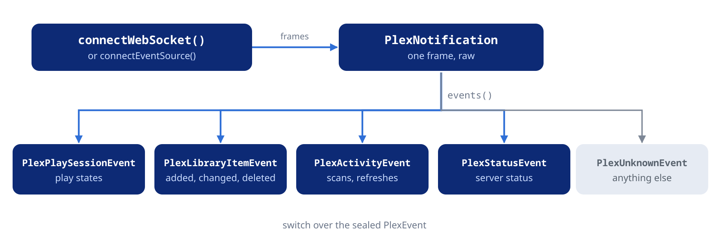

Follow the server's live notifications as typed events, download files to disk and drive the server's download queues.

## Notifications and events



### Connecting

```dart
final frames = await plex.notifications.connectWebSocket();
final subscription = frames.listen((frame) => print(frame.type));

// Later:
await subscription.cancel();
await plex.notifications.closeWebSocket();
```

`connectWebSocket()` returns once the socket is open, and throws a
`PlexException` when it cannot open: `connection`, `auth` when the server
refuses the token, `timeout` when the handshake takes longer than
`connectTimeout` (30 seconds), `state` when a socket is already open or
connecting.
`connectEventSource()` returns the same stream over Server-Sent Events,
for networks whose proxies block WebSockets; close it with
`closeEventSource()`. Both take an optional `filter` naming one frame
type (`'playing'`, `'activity'`). Each frame is a `PlexNotification` with
its `type` and `raw` body; `isWebSocketConnected` and
`isEventSourceConnected` tell which transport is open.

The event source sends its request when the stream gets its first
listener, so a failure to open arrives there as an error followed by the
end of the stream. Its frames come out in the WebSocket shape, whatever
the transport: the server names the type in the `event:` line and sends
one bare entry, and the package rebuilds `type` and the list of entries.

### When a stream ends

```dart
Future<void> follow(PlexClient plex) async {
  while (true) {
    try {
      final events = plex.notifications.connectEventSource().events();
      await for (final event in events) {
        print(event);
      }
    } on PlexException catch (e) {
      if (e.isAuthError) rethrow;
    }
    // Ended or failed: wait, then open a new one.
    await Future<void>.delayed(const Duration(seconds: 5));
  }
}
```

- Both streams are broadcast streams. A frame that arrives while nobody
  listens is dropped, so subscribe as soon as you have the stream.
- Cancelling the last subscription closes the connection, as
  `closeWebSocket()` and `closeEventSource()` do. `PlexClient.close()`
  closes both.
- There is no automatic reconnection. When the stream ends, open a new
  one; what changed in between is not replayed, so read the state again.
- The event source notices a dead connection: the server sends a ping
  every 10 seconds, and when nothing arrives for `idleTimeout` (60
  seconds, `null` to wait forever) the stream gets a `PlexException` of
  type `timeout` and ends. The WebSocket has no such check — the server
  answers only the first ping a client sends — so a connection that dies
  without a word (a suspended laptop, a dropped Wi-Fi) can stay open and
  silent. Prefer the event source where that matters.
- After a WebSocket ends on its own, `webSocketCloseCode` and
  `webSocketCloseReason` hold what the server sent with its close.
- A frame that cannot be read (invalid JSON, a binary frame) is dropped
  without an error, so one bad frame does not end an `await for`;
  `malformedFrameCount` counts them.

### Typed events

```dart
final frames = await plex.notifications.connectWebSocket();
final subscription = frames.events().listen((event) {
  switch (event) {
    case PlexPlaySessionEvent(:final ratingKey, :final state):
      print('$ratingKey is ${state.name}');
    case PlexLibraryItemEvent(:final itemId, isDeleted: true):
      print('$itemId was deleted');
    case PlexLibraryItemEvent(:final itemId, isReady: true):
      print('$itemId changed, read it again');
    case PlexActivityEvent(isLibraryScan: true, isEnded: true):
      print('scan finished, reload the library');
    case _:
  }
});
```

`events()` on a notification stream, or `PlexNotification.events` on one
frame (a frame can carry several entries), decodes frames into the
sealed `PlexEvent` type:

| Event | Frame type | Carries |
| :--- | :--- | :--- |
| `PlexPlaySessionEvent` | `playing` | A player's `PlexPlayState`, playhead, rating key, play queue ids |
| `PlexLibraryItemEvent` | `timeline` | An item created, changed, analysed or deleted (`isCreated`, `isReady`, `isDeleted`, `updatedAt`) |
| `PlexActivityEvent` | `activity` | A background activity started, progressed or ended; `isLibraryScan` |
| `PlexStatusEvent` | `status` | A server status message |
| `PlexUnknownEvent` | anything else | The whole frame in `raw` |

One library change arrives as several `PlexLibraryItemEvent`s as the item
moves through its states. New artwork arrives as a ready event with a new
`updatedAt`.

## Downloads

### Downloading to a file

```dart
import 'package:dart_plex/dart_plex.dart';
import 'package:dart_plex/io.dart';

Future<void> download(PlexClient plex, PlexMetadata track) async {
  final (url, ext) = plex.streaming.directFileUrl(
    partKey: track.media.first.parts.first.key!,
  );
  final bytes = await plex.downloadToFile(
    url,
    '/music/${track.ratingKey}.$ext',
    onProgress: (received, total) => print('$received / ${total ?? '?'}'),
  );
  print('$bytes bytes written');
}
```

`downloadToFile()` is an extension on `PlexClient` in
`package:dart_plex/io.dart`. It writes the body to a temporary file as it
arrives, so a whole track never sits in memory, and renames it to the
target path once complete. A failure, a stall past the receive timeout or
a cancellation removes the temporary file, leaves the target as it was
and throws a `PlexException`. `onProgress` gets the bytes received and
the total when the server sent a `Content-Length`. The call returns the
number of bytes written. Mind the MP3 note on the direct file URL in
[Streaming](https://pub.dev/documentation/dart_plex/latest/topics/Streaming-topic.html):
the server sends an MP3 without its ID3v2 tag.

### Download queues

`plex.downloadQueue` drives the server-side download queues that Plex's
mobile apps use for offline sync: `create()`, `get()`,
`add(queueId:, keys:)`, `items()`, `item()`, `remove()`, `restart()`,
`itemDecision()` and `itemMediaUrl()`. A queue is a `PlexDownloadQueue`
(one per client and user: `create()` returns the existing one), an entry
a `PlexDownloadQueueItem` with its `status`, `error` and `decision`; once
an item is `available`, download `itemMediaUrl()` with
`downloadToFile()`. The ids are `int`s, as `PlexDownloadQueue.id` is, and
`get()` and `item()` return `null` when the answer holds nothing. For a download of your own, `downloadToFile()` above
is enough.
