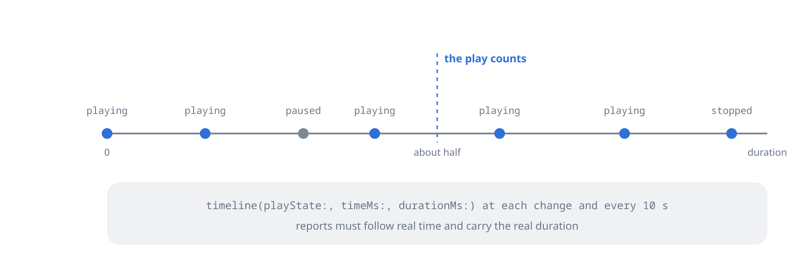

Report playback to the server, rate items, follow sessions and history, and keep a play queue on the server.

## Playback reporting



### Timeline reports

```dart
await plex.playback.timeline(
  ratingKey: track.ratingKey,
  playState: PlexPlayState.playing, // playing, paused, buffering or stopped
  timeMs: 42000,
  durationMs: track.durationMs!,
  playQueueItemID: queueItemId, // only when playing a server play queue
);
```

Send a report on every state change and every 10 s while playing on a
LAN (20 s on cellular). `durationMs` is the item's length and `timeMs`
the playhead, both in milliseconds. A `timeMs` past `durationMs` is sent
as `durationMs`. `timeline()` throws an `ArgumentError` for a `durationMs`
of 0 or less, a negative `timeMs` or `PlexPlayState.unknown`.

`playQueueItemID` is the entry id in a server play queue (see Play
queues below); leave it `null` otherwise. `continuing: true` says another
track follows in the same playback, so the server keeps the transcode
session, which matters during gapless prefetch.

### When a play counts

The server counts a play when:

* the reports follow real time: it clocks the session itself, so a
  `playing` at 0 and a `stopped` at the end a moment later count nothing;
* about half of the reported duration was played;
* `durationMs` is the real length: with a duration of 0 nothing ever
  counts. Very short tracks are not counted.

A counted play raises `viewCount`, sets `lastViewedAt` and adds an entry
to the playback history (see Playback history below).

### Scrobble and unscrobble

```dart
await plex.playback.scrobble(ratingKey: track.ratingKey);   // mark as played
await plex.playback.unscrobble(ratingKey: track.ratingKey); // mark as unplayed
```

`scrobble()` raises `viewCount` without adding a history entry: use it
for "mark as played", and timeline reports to record listening.
`unscrobble()` clears `viewCount` and keeps the history.

### Ratings and favourites

```dart
await plex.playback.rate(ratingKey: track.ratingKey, rating: 7.5); // 0 to 10
await plex.playback.setFavorite(ratingKey: track.ratingKey, isFavorite: true);
```

Plex has no favourite flag: a favourite is a `userRating` of 10.
`setFavorite()` rates 10 or 0, and `PlexMetadata.isFavorite` reads it
back. To list favourites, filter a section with
`PlexFilter.ratingAbove(9)` (see the filters in
[Library](https://pub.dev/documentation/dart_plex/latest/topics/Library-topic.html)).

## Sessions

`plex.sessions` shows what plays on the server at the moment and what
played before.

### Active sessions

```dart
final sessions = await plex.sessions.active();
for (final s in sessions) {
  print('${s.user?.title} → ${s.metadata.title}'
      ' (${s.player?.state}, ${s.viewOffsetMs} ms,'
      ' ${s.transcodeSession == null ? 'direct' : 'transcode'})');
}
```

Each `PlexSession` carries the item as `metadata`, plus `user`, `player`,
`bandwidth`, `transcodeSession` and the `sessionId` that `terminate()`
takes (see Terminating a session below).

### Playback history

```dart
final history = await plex.sessions.history(
  accountId: 1, // the owner
  mindate: DateTime.now()
          .subtract(const Duration(days: 30))
          .millisecondsSinceEpoch ~/
      1000,
  size: 100,
  sort: const PlexSort('viewedAt').desc,
);
print('${history.items.length} of ${history.totalSize}');
for (final h in history.items) {
  print('${h.viewedAt} ${h.grandparentTitle} - ${h.title}');
}
```

A page of `PlexHistoryEntry` (`historyKey`, `ratingKey`, `title`,
`parentTitle`, `grandparentTitle`, `type`, `viewedAt`, `accountId`,
`deviceId`, `librarySectionId`), with `totalSize` for paging. `mindate`
and `maxdate` are Unix seconds, both inclusive. `historyItem()` reads one
entry and `deleteHistoryEntry(historyKey:)` removes one. Past Live TV
plays are in the history too.

### Terminating a session

```dart
await plex.sessions.terminate(
  sessionId: session.sessionId!,
  reason: 'You started watching elsewhere',
);
```

`sessionId` is the session's own id, not the `session` of a transcode.
The user whose playback stops sees the `reason`.

## Play queues

A play queue is a queue kept on the server: the current item, what comes
next and the shuffled order. A Plex player you cast to reuses it, and
another device can add to it. Local playback works without one, from
`library` and `streaming`.

### Creating a queue

```dart
final machineId = (await plex.server.identity()).machineIdentifier;

final queue = await plex.playQueues.create(
  type: PlexMediaType.audio,
  uri: PlexPlayQueuesApi.seedFromItems(
    machineIdentifier: machineId,
    ratingKeys: const ['12345', '12346', '12347'],
  ),
);
final queueId = queue.id;
```

`seedFromItems()` builds the seed URI from rating keys; a URI for one
album or artist seeds the queue with its tracks. `key` names the first
item to play, and an album-seeded queue shuffles only when it is set.
`shuffle` (off) and `continuous` (on) set the queue's mode. A
`PlexPlayQueue` carries `id`, `selectedItemId`, `shuffled`, `version`
and its `items`.

### Reading and editing

```dart
// The queue around the current entry.
final items = await plex.playQueues.items(
  playQueueId: queueId,
  center: queue.selectedItemId,
  window: 50,
);
// Each entry's own id in the queue.
final entryId = items.last.playQueueItemId!;

// Append, or play next.
await plex.playQueues.addItems(
  playQueueId: queueId,
  uri: PlexPlayQueuesApi.seedFromItems(
    machineIdentifier: machineId,
    ratingKeys: const ['99999'],
  ),
  playNext: true,
);

// Append every track of a Plex playlist.
await plex.playQueues.addItems(
  playQueueId: queueId,
  playlistId: playlist.ratingKey,
);

// Move an entry to the start (no afterPlaylistItemId), or remove it.
await plex.playQueues.moveItem(playQueueId: queueId, playQueueItemId: entryId);
await plex.playQueues.removeItem(playQueueId: queueId, playQueueItemId: entryId);
```

`addItems()` takes either `uri` or `playlistId`, not both. Pass the entry
id as `playQueueItemID` in timeline reports (see Timeline reports above).

### Shuffle, reset and clear

```dart
await plex.playQueues.shuffle(playQueueId: queueId);
await plex.playQueues.unshuffle(playQueueId: queueId);
await plex.playQueues.reset(playQueueId: queueId); // first item is current again
await plex.playQueues.clear(playQueueId: queueId); // empty; the id stays valid
```
