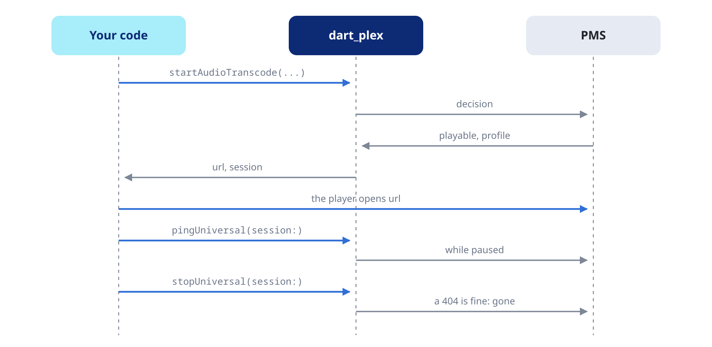

Build stream URLs for audio and video, manage transcode sessions, and read lyrics and loudness.



The streaming calls return URLs; none of them fetches the audio. Hand the
URL to your audio engine (mpv, AVPlayer, ExoPlayer). The URL carries
`X-Plex-Token` in its query, so segment requests need no headers.

## Audio transcode

```dart
final transcode = await plex.streaming.startAudioTranscode(
  ratingKey: track.ratingKey,
  session: 'my-uuid',   // one per playback session
  protocol: 'dash',     // 'hls' (default, an .m3u8) or 'dash' (an .mpd)
  maxBitrateKbps: 128,
);
if (transcode.decision.isPlayable) {
  print(transcode.url); // hand to the player
}
```

`startAudioTranscode()` asks the server for a decision for `session`,
then builds the `start` URL from the same parameters. It names a client
profile (`clientProfileName`, `'Generic'` by default), so it works from
any platform, and sends the transcode target and the bitrate cap the
server expects. `audioCodec` is `'aac'` by default; `offsetSeconds`,
`mediaIndex` and `partIndex` pick where and what to play. The cap cannot
go above the profile's own ceiling, 256 kbps AAC for `Generic`.

When `decision.isPlayable` is false the URL does not play either. Stop
each session you stop playing (see Transcode sessions below): while
other transcodes of the same client stay open, a new session's bitrate
cap may not apply. To make the decision yourself,
`PlexStreamingApi.musicProfileExtra()` builds the same profile value for
`decisionUniversal()`.

## Direct file URL

```dart
final (url, ext) = plex.streaming.directFileUrl(
  partKey: track.media.first.parts.first.key!,
);
```

The original file, with no transcode. Use it for downloads (see
[Events and downloads](https://pub.dev/documentation/dart_plex/latest/topics/Events%20and%20downloads-topic.html))
and for players that decode whatever the file contains. `ext` is the
file's extension.

The server sends an MP3 without its ID3v2 tag, so a downloaded MP3 has no
embedded tags or cover and is a little shorter than `PlexPart.size`. Take
metadata and artwork from the server.

## Transcode sessions

```dart
await plex.streaming.pingUniversal(session: sessionId); // keep alive
await plex.streaming.stopUniversal(session: sessionId); // tear down
```

The same calls serve audio and video sessions. The server drops a
session after about 2 minutes without requests: ping every 30 s while
the player is paused, and stop the session when the user leaves.
`pingUniversal()` throws a `PlexException` of type `notFound` once the
session is gone. `stopUniversal()` returns normally when the session no
longer exists, or never started: the server creates a DASH session with
its first segment.

## Video decision

For video, ask the server for a decision first. It weighs the source
against your client profile and answers with `generalDecisionCode`: 1xxx
means playback can succeed; 2xxx (general), 3xxx (direct play) and 4xxx
(transcode) are errors.

```dart
final decision = await plex.streaming.decisionUniversal(
  params: {
    'path': '/library/metadata/$ratingKey',
    'mediaIndex': 0,
    'partIndex': 0,
    'protocol': 'hls',
    'directPlay': 0,
    'directStream': 1,
    'videoResolution': '1920x1080',
    'maxVideoBitrate': 8000,
    'videoCodec': 'h264',
    'audioCodec': 'aac',
    'session': 'my-uuid',
  },
  extraHeaders: const {
    // The profile for this call only, instead of
    // PlexCredentials.clientProfileExtra.
    'X-Plex-Client-Profile-Extra':
        'add-transcode-target(type=videoProfile&context=streaming'
            '&protocol=hls&container=mpegts&videoCodec=h264&audioCodec=aac)',
  },
);

if (decision.isDirect) {
  // direct play or direct stream
} else if (decision.isTranscode) {
  // the server transcodes
} else {
  // not playable: bandwidth, codec mismatch, permissions
}
```

`transcodeType` is `'video'` by default; `'music'` and `'photo'` reach
the other transcoders. `isDirect` and `isTranscode` read
`directPlayDecisionCode` and `transcodeDecisionCode`; the whole answer is
in `raw`.

## Video URL

```dart
final url = plex.streaming.universalVideoUrl(
  ratingKey: ratingKey,
  videoResolution: '1920x1080',
  videoBitrate: 8000,
  audioBitrate: 256,
  videoCodec: 'h264',
  audioCodec: 'aac',
  subtitleSize: 100,
  session: 'my-uuid',
);
```

`protocol` (`'hls'` by default) and `container` (`'mpegts'`) pick the
target. The extension follows the protocol: `.m3u8` for HLS, `.mpd` for
DASH, the container otherwise. Bitrates are in kbps. The URL follows the
decision the server already made for the session.

## Transcoder URLs

`plex.transcoder` builds the raw transcoder URLs:

```dart
final cover = plex.transcoder.imageUrl(
  sourceUrl: album.thumb!,
  width: 600,
  height: 600,
  blur: 20,
  format: 'png',
);
final subtitles = plex.transcoder.subtitlesUrl(
  transcodeType: 'video',
  params: {'session': 'my-uuid'},
);
```

`imageUrl()` exposes every option of the photo transcoder (`quality`,
`blur`, `saturation`, `opacity`, `rotate`, `background`, `blendColor`).
`startUrl()` builds a `start.{extension}` URL from your own parameters,
and `triggerFallback()` asks the server for a full transcode after
direct play failed.

## Lyrics

```dart
final full = await plex.library.item(ratingKey: track.ratingKey);
final lyricsStream = full!.media.first.parts.first.streams
    .firstWhere((s) => s.isLyrics);
final lyrics = await plex.streaming.lyrics(streamKey: lyricsStream.key!);
```

The lyrics are a stream of the full item (`isLyrics`, stream type 4).
`lyrics()` returns the text, LRC or plain, or `null` when there is none.
It decodes the file whatever its encoding: a byte-order mark first
(removed, so the first `[mm:ss.xx]` still starts its line), then the
response's `charset`, then UTF-8 with Latin-1 as the fallback.

## Loudness

```dart
final full = await plex.library.item(ratingKey: track.ratingKey);
final audio = full?.audioStream;
if (audio != null && audio.hasLoudness) {
  print('track gain ${audio.gain} dB, album gain ${audio.albumGain} dB, '
      'peak ${audio.peak}, ${audio.loudness} LUFS');
}
```

An analysed audio stream carries `gain`, `albumGain`, `peak`,
`albumPeak`, `loudness` (LUFS) and `lra` (LU), from the server's own
analysis. They survive a transcode that drops the file's ReplayGain tags:
read them from the original stream and apply the gain to the transcoded
audio. `audioStream` is the selected audio stream of the first part.
